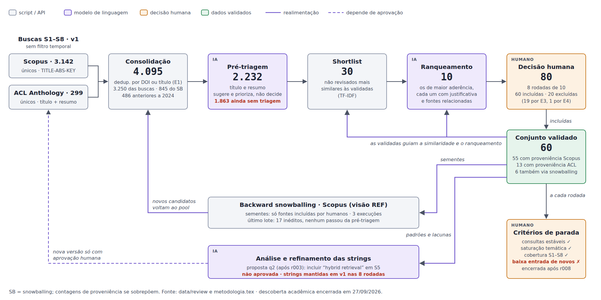
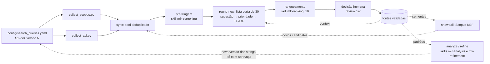

# Metodologia do TCC: engenharia de dados em sistemas RAG

Código, configuração e trilha de auditoria da **Revisão Multivocal da Literatura (MLR)** do TCC
*Engenharia de Dados em Sistemas RAG: Práticas, Desafios e Adaptações* (UnB/FGA), de Arthur Alves
Melo e Eric Silveira Gomes.

O repositório automatiza a parte acadêmica da revisão:

- coleta das famílias de busca S1–S8 na **Scopus** e na **ACL Anthology**;
- consolidação e deduplicação dos registros;
- pré-triagem e ranqueamento assistidos por modelo de linguagem;
- rodadas de dez candidatos para decisão humana;
- *backward snowballing*, análise de cobertura e proposta de refinamento das strings.

O texto do TCC não fica aqui; ele está no repositório do Overleaf.

## Estado atual

A descoberta acadêmica foi encerrada por decisão humana em 27/09/2026, após a rodada r008.

| Etapa | Quantidade |
|---|---:|
| Registros únicos na Scopus / na ACL Anthology | 3.142 / 299 |
| Publicações únicas das buscas diretas (após deduplicação entre bases) | 3.250 |
| Registros acrescentados pelo *backward snowballing* | 845 |
| Conjunto consolidado (pool) | 4.095 |
| Registros pré-triados pelo modelo | 2.232 |
| Decisões humanas (8 rodadas de 10) | 80 |
| Fontes preliminarmente incluídas | 60 |
| Excluídas (19 por E3, 1 por E4) | 20 |

Pendentes: leitura integral das 60 fontes, avaliação de qualidade (QA1–QA6), extração,
*forward snowballing* e toda a literatura cinzenta.

## Como funciona



Cada passo tem um responsável:
- **Scripts e APIs**: tudo o que é determinístico, como coletar, deduplicar e montar a lista curta.
- **Modelo de linguagem**: só sugere e prioriza, guiado pelas *skills* em `.claude/skills/`.
- **Pesquisadores**: todas as decisões de inclusão e exclusão.



Regras que o código impõe:

- **Registros não apresentados não são excluídos.** Quem não entrou entre os dez de uma rodada
  continua não revisado e pode aparecer depois.
- **O modelo não decide.** O ranqueamento precisa ter exatamente 10 candidatos da lista curta. Uma
  rodada só fecha com 10 decisões humanas, cada uma com justificativa e, quando houver exclusão,
  com o critério E1–E5.
- **Evidência literal.** Na pré-triagem, todo excerto citado pelo modelo precisa aparecer
  literalmente no resumo. Um lote com qualquer excerto não literal é rejeitado inteiro na
  importação.
- **Sem exclusão automática por data.** A única exclusão automática é a de duplicatas (E1).
  Registros anteriores ao recorte (`temporal_status: pre_cutoff`) são só marcados; quem decide
  E2 ou a exceção fundacional são os pesquisadores.
- **Strings versionadas.** Cada versão das strings tem uma impressão digital (SHA-256), e os
  dados brutos de cada versão ficam em `data/raw/<base>/q<N>/`. Uma nova versão só passa a valer
  depois de `register-queries`, com o revisor e a justificativa registrados.
- **Parada é decisão humana.** `status` calcula quatro indicadores: estabilidade das consultas,
  baixa entrada de novos estudos, saturação temática e cobertura S1–S8. Eles apoiam a decisão,
  mas não encerram o loop sozinhos.

## Estrutura

```
config/
  search_queries.yaml     fonte única das strings S1–S8 (versão atual)
  review_protocol.yaml    QPs, PICOC, I1–I3, E1–E5, recorte temporal, parâmetros das rodadas
src/
  search/                 geração das queries e matcher local (frases, wildcard *)
  collectors/             clientes e coletores Scopus e ACL (retry, paginação, retomada, cache)
  models/                 PaperRecord e proveniência (base, família, query, versão)
  review/                 workspace do loop, pool, lista curta TF-IDF, snowballing, análise
scripts/
  collect_scopus.py       coleta S1–S8 + enriquecimento de resumos (Abstract Retrieval)
  collect_acl.py          coleta S1–S8 sobre um snapshot local da ACL Anthology
  report.py               resumo das coletas a partir dos manifestos
  review_loop.py          CLI do loop de revisão (todos os passos abaixo)
.claude/skills/           skills de IA usadas no loop (.codex/skills aponta para as mesmas)
tests/                    testes automatizados (pytest)
data/
  manifests/              manifestos de cada coleta e de cada execução de snowballing
  review/                 trilha de auditoria da revisão (ver "Dados versionados")
outputs/                  diagrama da metodologia (SVG e PNG)
```

## Instalação

Requer Python 3.12 e git (a coleta da ACL clona o repositório oficial da Anthology).

```bash
python3.12 -m venv .venv
source .venv/bin/activate
pip install -r requirements.txt
cp .env.example .env        # e preencha as chaves
pytest                      # 97 testes, nenhum acessa a rede
```

Com [uv](https://docs.astral.sh/uv/): `uv venv --python 3.12 && uv pip install -r requirements.txt`.

### Chaves e segredos

As chaves ficam **somente** no `.env`, que está no `.gitignore`. O `.env.example` lista as
variáveis:

| Variável | Uso |
|---|---|
| `SCOPUS_API_KEY` | obrigatória para a Scopus ([dev.elsevier.com](https://dev.elsevier.com)) |
| `SCOPUS_INST_TOKEN` | opcional; dispensa o IP institucional para resumos e referências |
| `HTTPS_PROXY` | opcional; túnel para sair por um IP da universidade |

Os manifestos registram se houve proxy, mas nunca registram as chaves.

### Acesso à Scopus

A busca funciona com a chave pessoal. Os **resumos** (visão `META_ABS`) e as **referências**
usadas no snowballing (visão `REF`) exigem direito de acesso institucional. Sem esse direito, a
API responde `401`. Há duas formas de obtê-lo:

- **Rede da universidade:** rodar a coleta com a máquina conectada à rede da UnB.
- **Túnel SOCKS:** fora da rede, abrir um túnel por SSH até uma máquina dentro dela e apontar o
  proxy para ele:

  ```bash
  ssh -D 1080 -N usuario@maquina-na-rede-da-unb   # em outro terminal
  export HTTPS_PROXY=socks5h://127.0.0.1:1080      # ou defina no .env
  ```

O suporte a SOCKS vem de `requests[socks]`, que já está nos requisitos.

## Coleta

```bash
python scripts/collect_acl.py              # clona/atualiza a ACL Anthology e pesquisa título + resumo
python scripts/collect_scopus.py           # TITLE-ABS-KEY + enriquecimento dos resumos
python scripts/report.py                   # resumo por família a partir dos manifestos
```

Opções úteis:

- `--family S4` (repetível) executa só as famílias indicadas.
- Nos dois coletores:
  - `--output-dir DIR` muda o diretório de dados (padrão: `data/`);
  - `--config ARQ` usa outro arquivo de strings.
- Na Scopus:
  - uma execução interrompida é retomada na próxima chamada;
  - `--force` ignora o cache;
  - `--skip-enrichment` pula a busca de resumos.
- Na ACL:
  - `--no-update` usa o snapshot local sem `git pull`;
  - `--repo-path` aponta para um clone existente.

Saídas:

- **Registros:** `data/raw/<base>/q<N>/` guarda um arquivo por família e `all_records.jsonl`.
- **Manifestos:** `data/manifests/<base>/<timestamp>.json`. Cada um registra:
  - as strings executadas e sua impressão digital;
  - os campos pesquisados e as contagens por família;
  - a paginação e o uso de API;
  - na ACL, o commit do snapshot.

Nenhuma coleta aplica filtro temporal.

## Loop da revisão

Todos os comandos são subcomandos de `python scripts/review_loop.py`. O workspace fica em
`data/review/`.

| Passo | Comando | Quem age |
|---|---|---|
| Criar o workspace e registrar as strings v1 | `init --reviewer NOME` | script |
| Mudar o protocolo (por exemplo, o recorte temporal) | `protocol-update --reviewer NOME --justification "..."` | humano |
| Consolidar coletas e snowballing no pool | `sync` | script |
| Gerar lotes de pré-triagem | `pretriage-batches` | script |
| Pré-triar cada lote | skill **mlr-screening** escreve `batch_NNNN.output.jsonl` | IA |
| Importar e validar os lotes | `import-pretriage` | script |
| Abrir rodada (lista curta de 30) | `round-new` | script |
| Escolher os 10 candidatos | skill **mlr-ranking** escreve `ranking.input.json` | IA |
| Importar o ranqueamento | `round-rank rNNN data/review/rounds/rNNN/ranking.input.json` | script |
| Decidir os 10 | preencher `rounds/rNNN/review.csv`, depois `round-review rNNN data/review/rounds/rNNN/review.csv` | humano |
| Fechar a rodada | `round-close rNNN` | script |
| Cobertura e pacote de análise | `analyze`, depois a skill **mlr-analysis** | script, depois IA |
| *Backward snowballing* na Scopus | `snowball --direction backward` | script |
| Proposta de novas strings | `refine`, depois a skill **mlr-refinement** | IA |
| Aprovar uma nova versão das strings | editar `config/search_queries.yaml`, depois `register-queries --reviewer NOME --justification "..."` | humano |
| Progresso e indicadores de parada | `status` | script |

Detalhes:

- **Planilha da rodada:** `review.csv` traz os metadados, o resumo e a sugestão e a justificativa
  da IA. Os pesquisadores preenchem:
  - `decision`: `include`, `exclude` ou `full_text`;
  - `criterion`: E1–E5, quando houver exclusão;
  - `foundational`: para a exceção temporal de I1;
  - `justification`, `reviewer` e `suggested_terms` (opcional).

  Para registrar uma decisão isolada, use `decide`.
- **Snowballing:**
  - `--seed-source validated` (padrão) usa apenas fontes incluídas por humanos;
  - `--seed-source pretriage-high` usa sementes provisórias da pré-triagem;
  - `--seed-origin acl|scopus` restringe as sementes pela base de origem;
  - `--max-seeds N` limita o número de sementes.

  A política usada em cada execução fica registrada no manifesto. As strings S1–S8 não são
  reaplicadas no snowballing.
- **Auditoria:** `audit-new` sorteia registros da pré-triagem para conferência humana, e
  `audit-import` importa a conferência.
- **Reprodutibilidade:** o identificador de cada registro (`P-xxxxxxxxxxxx`) é um hash do DOI ou do
  título normalizado. Refazer as coletas reproduz os mesmos identificadores, e as decisões
  versionadas continuam apontando para os mesmos registros.

### Skills

As skills são instruções em Markdown que o agente (Claude Code ou Codex) segue em cada passo de IA:

| Skill | Quando | Entrada | Saída |
|---|---|---|---|
| `mlr-screening` | pré-triagem | `pretriage/batches/*.input.jsonl` | sugestão, prioridade, etapas, dimensões e excerto literal |
| `mlr-ranking` | cada rodada | `rounds/rNNN/shortlist.jsonl` + fontes validadas | exatamente 10 candidatos justificados |
| `mlr-analysis` | após as rodadas | `analysis/packet_rNNN.json` | padrões, lacunas e cobertura em relação a QP1–QP3 |
| `mlr-refinement` | refinamento | `refinement/packet_*.json` | proposta de termos para incluir, remover ou substituir, que os pesquisadores aprovam |

No Claude Code, as skills aparecem automaticamente com o repositório aberto. No Codex, elas
estão em `.codex/skills/`, que são links para os mesmos arquivos.

## Dados versionados

O repositório é público, e os termos da API da Elsevier não permitem redistribuir resumos e
metadados completos da Scopus. Por isso, ficam fora do git:
- `data/raw/`;
- o pool (`pool.jsonl`);
- as entradas da pré-triagem;
- as listas curtas e as planilhas das rodadas;
- os pacotes de análise.

Todos esses arquivos são regenerados pelos coletores e pelo `review_loop.py`.

Ficam versionados, sem resumos, como trilha de auditoria:

| Caminho | Conteúdo |
|---|---|
| `data/manifests/` | todas as coletas e execuções de snowballing (parâmetros, contagens, sementes) |
| `data/review/workspace.json` | rodadas, versões das strings, mudanças de protocolo, sincronizações |
| `data/review/decisions.jsonl` | as 80 decisões humanas, com critério e justificativa |
| `data/review/pretriage/pretriage.jsonl` | sugestões da IA, com modelo, versão do prompt e excerto citado |
| `data/review/rounds/*/ranking.json` | os 10 candidatos escolhidos pela IA em cada rodada |
| `data/review/analysis/`, `data/review/refinement/` | notas de análise, cobertura por rodada e a proposta q2 |
| `data/review/protocols/`, `data/review/queries/` | versões do protocolo e das strings |

Para continuar o loop num clone novo:
1. Rode as duas coletas e o `snowball`, para regenerar `data/raw/`.
2. Rode `sync`, para reconstruir o pool.
3. Rode `status`.

A pré-triagem e as decisões já versionadas continuam válidas, porque apontam para os mesmos
identificadores.

## Limitações conhecidas

- **Cobertura da pré-triagem:** cobriu 2.232 dos 4.095 registros. Os demais continuam não
  revisados.
- **Literatura cinzenta:** as três frentes descritas no TCC (DEV Community, Hacker News via
  Algolia e portais institucionais) ainda não têm coletor neste repositório.
- **IEEE Xplore e ACM Digital Library:** só tiveram consultas exploratórias, sem coletor.
- ***Forward snowballing*:** está implementado (`--direction forward`, via `REFEID` na Scopus),
  mas não foi executado.
- **Questões de pesquisa no protocolo:** as QPs e a PICOC de `config/review_protocol.yaml` são as
  da versão usada na triagem. O texto atual do TCC reformulou QP2 e QP3. Atualize
  `config/review_protocol.yaml` e registre a nova versão com `protocol-update` antes de novas
  rodadas.
